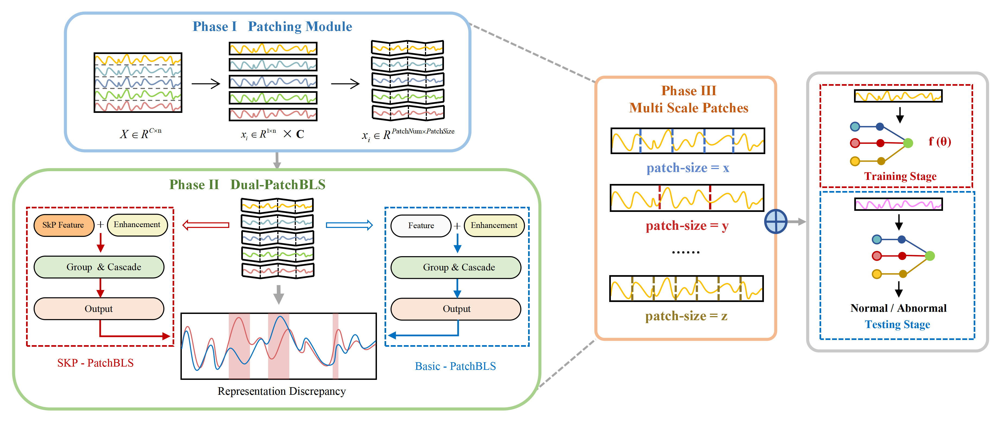

## 📑 A New Perspective on Time Series Anomaly Detection: Faster Patch-based Broad Learning System

This is the official implementation of **A New Perspective on Time Series Anomaly Detection: Faster Patch-based Broad Learning System.** The paper has been accepted by **Fundamental Research** (2026, JCR Q1, IF 7.0).

## 📰 Abstract



While deep learning has become mainstream for time series anomaly detection (TSAD) due to its high performance, its practical application is somewhat limited by slow speed. The Broad Learning System (BLS) is a shallow network framework that benefits from its ease of optimization and speed. It has been shown to outperform machine learning approaches while remaining competitive with deep learning. Based on the current situation of TSAD, we propose the Discrepancy-oriented Patch-based Broad Learning System (DPatchBLS). This innovative integration of patching techniques and BLS offers a novel approach for TSAD, particularly in improving detection efficiency and accuracy. We construct Dual-PatchBLS as the basic framework through patching and Simple Kernel Perturbation (SKP) and utilize the representation discrepancy mechanism to capture the differences between normal and abnormal data. To compensate for the temporal semantic loss caused by various patching, we propose DPatchBLS with model-level integration by ensemble learning, which takes advantage of BLS's fast feature to build model-level integration and improve model detection. Using four real-world time series anomaly detection datasets, we confirmed the efficacy of the proposed method, which exhibits strong competitiveness relative to previous deep learning and machine learning methods while retaining a high level of computing efficiency.

## 🗂️ Code Structure

```text
main.py                   # entry
scripts/                  # run scripts for MSL, PSM, Swan, and SMD
data/loader.py            # load the four datasets
model/patch_model/        # Dual-PatchBLS and multi-scale patches
model/layer/patch_bls.py  # basic branch and SKP branch
model/trainer.py          # training and testing
model/evaluate.py         # AUC-ROC, AUC-PR, F1, R-AUC-ROC, VUS-ROC
bls_torch/layers/         # feature nodes, enhancement nodes, output layer
metrics/vus/              # range AUC and VUS
```

## 💾 Datasets

You can download all real-world datasets [here](https://drive.google.com/drive/folders/1RaIJQ8esoWuhyphhmMaH-VCDh-WIluRR?usp=sharing). (Thanks for [DCdetector](https://github.com/DAMO-DI-ML/KDD2023-DCdetector/blob/main/readme.md) repo and its authors.)

## 🔧 Installation

You can refer to requirements.txt to install all the packages.
> pip install -r requirements.txt

## 🚀 Quick Start

1. Download the corresponding datasets and set the specific paths of the datasets in the main file.
2. Run the scripts.

## 🙏 Acknowledgements

We thank the authors and developers of the following repositories:

- pyod: https://github.com/yzhao062/pyod
- DeepOD: https://github.com/xuhongzuo/DeepOD
- TSB-AD: https://github.com/TheDatumOrg/TSB-AD
- KAN-AD: https://github.com/issaccv/KAN-AD
- Time-RCD: https://github.com/thu-sail-lab/Time-RCD

## 📝 Citation

```bibtex
@article{li2024new,
  title={A new perspective on time series anomaly detection: Faster patch-based broad learning system},
  author={Li, Pengyu and Zhong, Zhijie and Zhang, Tong and Yu, Zhiwen and Chen, CL and Yang, Kaixiang},
  journal={arXiv preprint arXiv:2412.05498},
  year={2024}
}
```
